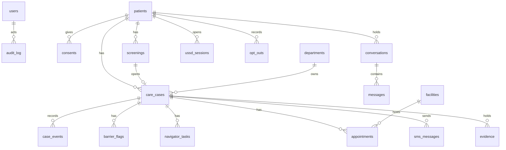

# Database Design

Status: design. SQLite by default through SQLAlchemy, migrations through Alembic. Names are proposals and will be refined during implementation. Aligned with the README on 2026-11-16 (pre-hospital navigation).

## Conventions

- Primary keys: integer `id`. Foreign keys enforced (`PRAGMA foreign_keys=ON`).
- Timestamps: UTC, ISO 8601.
- JSON fields are stored as text in SQLite.
- Patients are identified by a pseudonymous `patient_ref` (for example `CL-000123`). All demo data is synthetic.
- Audit and case-event tables are append-only in application code (no update or delete endpoints).
- Each table belongs to one backend module; other modules use that module's service functions.
- Tables marked "Exists in code" are already implemented on `feature/backend-case-engine`; adapt them instead of recreating them.
- Confidential conversation tables are separate from case tables and readable only by the roles that need them.
- Nothing stored for an SMS or USSD screen contains a result, diagnosis or sensitive wording.

## Entity relationships

## Tables

| Table | Module | Key columns | Notes |
|---|---|---|---|
| `users` | auth | username, password_hash, role, display_name, department_id, active | Exists in code. Roles: navigator (renamed from coordinator), counsellor (new), clinician, program_manager, admin |
| `departments` | auth | name, label, type | Exists in code. Owner groups for pathway stages, for example screening, navigation, clinic |
| `facilities` | facilities | name, type, zone (synthetic), accepts_appointments | Small synthetic directory |
| `patients` | patients | patient_ref, display_name (synthetic), age_band, zone (synthetic), preferred_language, is_synthetic, contact_ref (synthetic), channel_preference | Exists in code. No real identifiers. `contact_ref` and `channel_preference` are new |
| `consents` | patients | patient_id, purpose, granted, granted_at, revoked_at | Exists in code. New purposes: invitation, sms_contact, share_barriers_with_navigator (replacing care_coordination, sms_reminders, data_sharing_between_facilities). Purpose-specific and revocable |
| `opt_outs` | patients | patient_id, scope, recorded_at | Scope: sms_stop or leave_programme. Honoured immediately |
| `screenings` | screenings | patient_id, screening_type, result, performed_at, department_id, recorded_by, invited_with_consent | Exists in code. A concerning finding, not a diagnosis. `invited_with_consent` is new |
| `care_cases` | pathways | patient_id, source_screening_id, pathway_id, pathway_version, state, urgency, owner_user_id, owner_department_id, state_entered_at, deadline_at, opened_at, closed_at, closure_reason | Exists in code. One row per tracked case |
| `case_events` | pathways | case_id, from_state, to_state, actor_id, actor_type (user/system/ai), occurred_at, note | Exists in code. Append-only timeline |
| `evidence` | pathways | case_id, type, description, reference, recorded_by, recorded_at | Exists in code. Required to close a case. Hospital milestones from the mock hospital are stored here |
| `barrier_flags` | barriers | case_id, barrier_type, source, detected_at, confirmed_by_patient, confirmed_at, shared_with_navigator | Types: fear, cost, transport, stigma, not_knowing_where. Source: lite_text, menu, navigator. Only confirmed flags are visible to a navigator |
| `navigator_tasks` | tasks | case_id, task_type, reason, assigned_user_id, due_at, status, completed_at, created_by | Replaces the existing `escalations` table; start from that model. Created by the system or a navigator. Types: barrier, unconfirmed_reminder, undelivered_sms, missed_appointment, stalled, milestone_check |
| `appointments` | appointments | case_id, patient_id, facility_id, requested_at, scheduled_at, status, reminder_status | Status: requested, confirmed, attended, missed, cancelled |
| `sms_messages` | channels | case_id, patient_id, direction, template_id, body, status, reply_code, created_at, delivered_at | Status: queued, delivered, undelivered, replied. Reply codes 1, 2, 3, STOP |
| `ussd_sessions` | channels | session_ref, patient_id, current_menu, started_at, ended_at | Simulated |
| `conversations` | assistant | patient_id, channel, started_at, handed_off_at | Confidential |
| `messages` | assistant | conversation_id, role, text, tier, source_ref, created_at | Tier: safety, lite, retrieval, model. Confidential |
| `knowledge_passages` | assistant | passage_ref, text, source_ref, review_status, language | Loaded from files under `ai/`. Every passage names its source and review status |
| `audit_log` | audit | occurred_at, actor_id, actor_type, role, action, entity_type, entity_id, patient_id, detail (JSON), outcome | Exists in code. Written on every state change and case access |

## FHIR concept mapping (design, simulated)

The mock hospital exchanges FHIR R4 resources with CareLoop over HTTP. Everything about this exchange is simulated, and no live integration is claimed.

| CareLoop | FHIR resource (concept) |
|---|---|
| patients | Patient |
| appointments | Appointment (request out, status back) |
| evidence (hospital milestones) | Encounter or Task (choose one and record it in the technical decisions) |
| consents | Consent |
| sms_messages | Communication |
| audit_log | AuditEvent |

## Seed data

`database/seeds/` will generate synthetic patients, flags, conversations and pathway events, with injected missed appointments and drop-offs. Every generated record is marked synthetic. Rates used are assumptions and are documented next to the generator.

## Open questions

- Where consent is captured (screener at invitation, or inside the first channel session).
- Whether the mock hospital keeps its own database or only an in-memory store.
- Whether `facilities` needs more than a name, type and sub-county for the demo.
