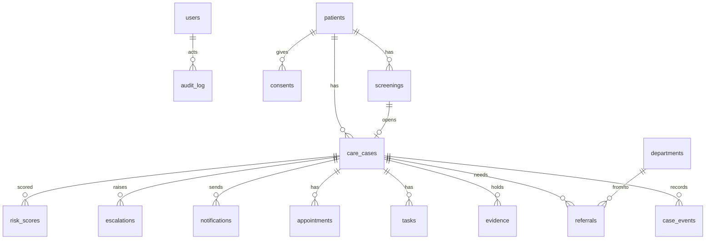

# Database Design

Status: design. SQLite by default through SQLAlchemy, migrations through Alembic. Names are proposals and will be refined during implementation.

## Conventions

- Primary keys: integer `id`. Foreign keys enforced (`PRAGMA foreign_keys=ON`).
- Timestamps: UTC, ISO 8601.
- JSON fields are stored as text in SQLite.
- Patients are identified by a pseudonymous `patient_ref` (for example `CL-000123`). All demo data is synthetic.
- Audit and case-event tables are append-only in application code (no update or delete endpoints).
- Each table belongs to one backend module; other modules use that module's service functions.

## Entity relationships

## Tables

| Table | Module | Key columns | Notes |
|---|---|---|---|
| `users` | auth | username, password_hash, role, display_name, department_id, active | Roles: coordinator, clinician, program_manager, admin |
| `departments` | auth | name, type | For example screening clinic, gynaecology clinic, treatment unit |
| `patients` | patients | patient_ref, display_name (synthetic), age_band, sub_county (synthetic), preferred_language, contact_ref (synthetic) | No real identifiers |
| `consents` | patients | patient_id, purpose, granted, granted_at, revoked_at | Purpose-specific and revocable |
| `screenings` | screenings | patient_id, screening_type, performed_at, result, department_id | Types such as HPV test, VIA; results positive, negative, inadequate, suspected cancer |
| `care_cases` | pathways | patient_id, source_screening_id, pathway_id, pathway_version, state, urgency, owner_user_id, owner_department_id, state_entered_at, deadline_at, opened_at, closed_at, closure_reason | One row per tracked case |
| `case_events` | pathways | case_id, from_state, to_state, actor_id, actor_type (user/system/ai), occurred_at, note | Append-only timeline |
| `evidence` | pathways | case_id, type, description, reference, recorded_by, recorded_at | Required to close a case |
| `escalations` | pathways | case_id, level, reason, raised_at, resolved_at, resolved_by | Raised by the deadline checker or by staff |
| `referrals` | referrals | case_id, from_department_id, to_department_id, reason, status, sent_at, responded_at, rejection_reason | Status: draft, sent, accepted, rejected, completed |
| `tasks` | tasks | case_id, title, assigned_user_id, assigned_department_id, due_at, status, completed_at | |
| `appointments` | tasks | case_id, patient_id, department_id, scheduled_at, status, outcome_note | Status: scheduled, attended, missed, cancelled |
| `notifications` | notifications | case_id, patient_id, channel, template_id, body, status, drafted_by, reviewed_by, created_at, sent_at, acknowledged_at | Status: drafted, approved, rejected, sent_simulated, acknowledged. No real sending |
| `risk_scores` | risk | case_id, score, method, factors (JSON), computed_at | Method starts as a transparent rule set |
| `audit_log` | audit | occurred_at, actor_id, role, action, entity_type, entity_id, patient_id, detail (JSON), outcome | Written on every state change and case access |

## FHIR concept mapping (design only)

No live FHIR exchange is implemented or claimed. This is the planned mapping for the stretch `interop` module.

| CareLoop | FHIR resource (concept) |
|---|---|
| patients | Patient |
| screenings | Observation / DiagnosticReport |
| care_cases | EpisodeOfCare or CarePlan |
| referrals | ServiceRequest |
| tasks | Task |
| appointments | Appointment |
| consents | Consent |
| notifications | Communication |
| audit_log | AuditEvent |

## Seed data

`database/seeds/` will generate synthetic patients, screenings and pathway events with injected delays and drop-offs. Every generated record is marked synthetic. Rates used are assumptions and are documented next to the generator.

## Open questions

- Whether `departments` should model facilities as well, to show cross-facility referrals.
- Whether the demo needs soft deletion; the current design avoids deleting clinical records.
